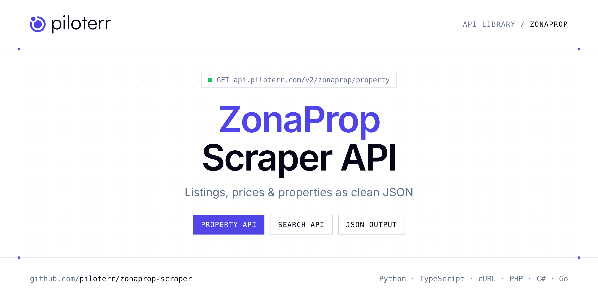

<p align="center">
  <a href="https://www.piloterr.com"></a>
</p>

# ZonaProp Scraper API

[](https://discord.gg/CFj3ph8aHU) [](https://app.piloterr.com) [](https://app.piloterr.com/openapi) [](LICENSE)

The **Piloterr ZonaProp Scraper API** lets you extract public data from ZonaProp as **clean, structured JSON** — no proxies, headless browsers or HTML parsing to maintain. Endpoints available in production:

- **ZonaProp Property API** — Read one ZonaProp listing from its URL.
- **ZonaProp Search API** — Search ZonaProp for apartments or houses in an Argentine city.

Use it for property price monitoring, market analytics, investment sourcing or rental yield models.

| Endpoint | Path | Credits | What you get |
|---|---|---|---|
| [ZonaProp Property API](#zonaprop-property-api) | `/v2/zonaprop/property` | 2 | Read one ZonaProp listing from its URL. You get the asking price in USD or ARS, the address, and the publisher. |
| [ZonaProp Search API](#zonaprop-search-api) | `/v2/zonaprop/search` | 2 | Search ZonaProp for apartments or houses in an Argentine city. Page with pagina. A few featured ads can repeat. Development projects priced 'from' are left out. |

## Table of contents

- [How it works](#how-it-works)
- [ZonaProp Property API](#zonaprop-property-api)
- [ZonaProp Search API](#zonaprop-search-api)
- [Code examples in other languages](#code-examples-in-other-languages)
- [Practical use cases](#practical-use-cases)
- [Why Piloterr?](#why-piloterr)
- [FAQ](#faq)
- [Related scrapers](#related-scrapers)
- [Support](#support)

## How it works

1. **Create a free Piloterr account** and copy your API key from the [dashboard](https://app.piloterr.com).
2. **Send a `GET` (or `POST`) request** to `https://api.piloterr.com/v2/...` with the header `x-api-key: YOUR_API_KEY`.
3. **Receive structured JSON** — Piloterr handles rendering, proxies, retries and parsing.

```bash
export PILOTERR_API_KEY="your-api-key"
pip install requests        # Python
# TypeScript: Node.js 18+ (native fetch), run with `npx tsx file.ts`
```

> Every endpoint accepts both `GET` (query string) and `POST` (JSON body with the same fields).

## ZonaProp Property API

Read one ZonaProp listing from its URL. You get the asking price in USD or ARS, the address, and the publisher.

`GET | POST https://api.piloterr.com/v2/zonaprop/property` · **2 credits per request** · [Full reference](https://app.piloterr.com/openapi)

### Request parameters

| Parameter | Type | Required | Description |
|---|---|---|---|
| `query` | string | ✅ | ZonaProp listing URL under /propiedades/clasificado/. |

### Python example

```python
import json
import os
import requests

response = requests.get(
    "https://api.piloterr.com/v2/zonaprop/property",
    headers={"x-api-key": os.environ["PILOTERR_API_KEY"]},
    params={
        "query": "https://www.zonaprop.com.ar/propiedades/clasificado/veclapin-venta-departamento-2-ambientes-villa-crespo-59096735.html",
    },
    timeout=120,
)
response.raise_for_status()
data = response.json()

print(json.dumps(data, indent=2, ensure_ascii=False)[:2000])
```

### TypeScript example

```typescript
type ZonapropProperty = {
  id?: string;
  url?: string;
  area?: number;
  city?: string;
  image?: string;
  price?: number;
  rooms?: number;
  title?: string;
  images?: string[];
  address?: string;
  bedrooms?: number;
  currency?: string;
  features?: string[];
  latitude?: number;
  antiquity?: string;
  bathrooms?: number;
  longitude?: number;
  operation?: string;
  description?: string;
  area_display?: string;
  covered_area?: number;
  neighborhood?: string;
  published_at?: string;
  price_display?: string;
  property_type?: string;
  [key: string]: unknown;
};

const params = new URLSearchParams({
  "query": "https://www.zonaprop.com.ar/propiedades/clasificado/veclapin-venta-departamento-2-ambientes-villa-crespo-59096735.html",
});

const response = await fetch(`https://api.piloterr.com/v2/zonaprop/property?${params}`, {
  headers: { "x-api-key": process.env.PILOTERR_API_KEY! },
});
if (!response.ok) throw new Error(`Piloterr error ${response.status}: ${await response.text()}`);

const data = (await response.json()) as ZonapropProperty;

console.log(JSON.stringify(data, null, 2).slice(0, 2000));
```

<details>
<summary><b>POST variant</b></summary>

```http
POST https://api.piloterr.com/v2/zonaprop/property
x-api-key: YOUR_API_KEY
Content-Type: application/json

{"query": "https://www.zonaprop.com.ar/propiedades/clasificado/veclapin-venta-departamento-2-ambientes-villa-crespo-59096735.html"}
```
</details>

### Output example

Example response from the API reference, abridged — real values depend on the page you scrape.

```json
{
  "id": "59096735",
  "url": "https://www.zonaprop.com.ar/propiedades/clasificado/veclapin-venta-departamento-2-ambientes-villa-crespo-59096735.html",
  "area": 53,
  "city": "Capital Federal",
  "image": "https://imgar.zonapropcdn.com/avisos/1/00/59/09/67/35/720x532/2052496641.jpg?isFirstImage=true",
  "price": 149773,
  "rooms": 2,
  "title": "Venta Departamento 2 Ambientes Villa Crespo - Financiación",
  "images": [
    "https://imgar.zonapropcdn.com/avisos/1/00/59/09/67/35/720x532/2052496641.jpg?isFirstImage=true",
    "https://imgar.zonapropcdn.com/avisos/1/00/59/09/67/35/720x532/2052496645.jpg"
  ],
  "address": "Av. Estado de Israel 4620",
  "bedrooms": 1,
  "currency": "USD",
  "features": [
    "Parrilla",
    "Ascensor"
  ],
  "latitude": -34.6,
  "antiquity": "2",
  "bathrooms": 1,
  "longitude": -58.43,
  "operation": "venta",
  "description": "VENTA DEPARTAMENTO 2 AMBIENTES EN VILLA CRESPO\nACEPTA CRIPTOMONEDAS\nACEPTA PERMUTA\nFINANCIACIÓN DISPONIBLE.\nEDIFICIO EN CONSTRUCCIÓN EN E…",
  "area_display": "53 m² tot.",
  "covered_area": 48,
  "neighborhood": "Villa Crespo",
  "published_at": "2026-05-12T22:30:30Z",
  "price_display": "USD 149.773",
  "property_type": "Apartamento"
}
```

### Response fields

| Field | Type | Description |
|---|---|---|
| `id` | string |  |
| `url` | string |  |
| `area` | integer |  |
| `city` | string |  |
| `image` | string |  |
| `price` | integer |  |
| `rooms` | integer |  |
| `title` | string |  |
| `images` | string[] |  |
| `address` | string |  |
| `bedrooms` | integer |  |
| `currency` | string |  |
| `features` | string[] |  |
| `latitude` | number |  |
| `antiquity` | string |  |
| `bathrooms` | integer |  |
| `longitude` | number |  |
| `operation` | string |  |
| `description` | string |  |
| `area_display` | string |  |
| `covered_area` | integer |  |
| `neighborhood` | string |  |
| `published_at` | string |  |
| `price_display` | string |  |
| `property_type` | string |  |

## ZonaProp Search API

Search ZonaProp for apartments or houses in an Argentine city. Page with pagina. A few featured ads can repeat. Development projects priced 'from' are left out.

`GET | POST https://api.piloterr.com/v2/zonaprop/search` · **2 credits per request** · [Full reference](https://app.piloterr.com/openapi)

### Request parameters

| Parameter | Type | Required | Description |
|---|---|---|---|
| `query` | string | ✅ | Place or a ZonaProp search URL. |
| `operation` | string | — | Sale or rent when query is a place. |
| `property_type` | string | — | Kind of property. Default departamentos. |
| `page` | number | — | Page from 1. ZonaProp writes this into the path as -pagina-N.html. |

### Python example

```python
import json
import os
import requests

response = requests.get(
    "https://api.piloterr.com/v2/zonaprop/search",
    headers={"x-api-key": os.environ["PILOTERR_API_KEY"]},
    params={
        "query": "capital federal",
    },
    timeout=120,
)
response.raise_for_status()
data = response.json()

print(json.dumps(data, indent=2, ensure_ascii=False)[:2000])
```

### TypeScript example

```typescript
type ZonapropSearch = {
  results?: {
    id?: string;
    url?: string;
    area?: number;
    city?: string;
    image?: string;
    price?: number;
    rooms?: number;
    title?: string;
    address?: string;
    bedrooms?: number;
    currency?: string;
    bathrooms?: number;
    operation?: string;
    area_display?: string;
    neighborhood?: string;
    price_display?: string;
  }[];
  pagination?: {
    next?: string;
    page?: number;
    per_page?: number;
    total_pages?: number;
    total_results?: number;
  };
};

const params = new URLSearchParams({
  "query": "capital federal",
});

const response = await fetch(`https://api.piloterr.com/v2/zonaprop/search?${params}`, {
  headers: { "x-api-key": process.env.PILOTERR_API_KEY! },
});
if (!response.ok) throw new Error(`Piloterr error ${response.status}: ${await response.text()}`);

const data = (await response.json()) as ZonapropSearch;

console.log(JSON.stringify(data, null, 2).slice(0, 2000));
```

<details>
<summary><b>POST variant</b></summary>

```http
POST https://api.piloterr.com/v2/zonaprop/search
x-api-key: YOUR_API_KEY
Content-Type: application/json

{"query": "capital federal"}
```
</details>

### Output example

Example response from the API reference, abridged — real values depend on the page you scrape.

```json
{
  "results": [
    {
      "id": "59096735",
      "url": "https://www.zonaprop.com.ar/propiedades/clasificado/veclapin-venta-departamento-2-ambientes-villa-crespo-59096735.html",
      "area": 53,
      "city": "Capital Federal",
      "image": "https://imgar.zonapropcdn.com/avisos/1/00/59/09/67/35/360x266/2052496641.jpg?isFirstImage=true",
      "price": 149773,
      "rooms": 2,
      "title": "Venta Departamento 2 Ambientes Villa Crespo - Financiación",
      "address": "Av. Estado de Israel 4620",
      "bedrooms": 1,
      "currency": "USD",
      "bathrooms": 1,
      "operation": "venta",
      "area_display": "53 m² tot.",
      "neighborhood": "Villa Crespo",
      "price_display": "USD 149.773"
    }
  ],
  "pagination": {
    "next": "https://www.zonaprop.com.ar/departamentos-venta-capital-federal-pagina-2.html",
    "page": 1,
    "per_page": 30,
    "total_pages": 2462,
    "total_results": 73847
  }
}
```

### Response fields

| Field | Type | Description |
|---|---|---|
| `results[]` | object[] |  |
| `results[].id` | string |  |
| `results[].url` | string |  |
| `results[].area` | integer |  |
| `results[].city` | string |  |
| `results[].image` | string |  |
| `results[].price` | integer |  |
| `results[].rooms` | integer |  |
| `results[].title` | string |  |
| `results[].address` | string |  |
| `results[].bedrooms` | integer |  |
| `results[].currency` | string |  |
| `results[].bathrooms` | integer |  |
| `results[].operation` | string |  |
| `results[].area_display` | string |  |
| `results[].neighborhood` | string |  |
| `results[].price_display` | string |  |
| `pagination` | object |  |
| `pagination.next` | string |  |
| `pagination.page` | integer |  |
| `pagination.per_page` | integer |  |
| `pagination.total_pages` | integer |  |
| `pagination.total_results` | integer |  |

## Code examples in other languages

Ready-to-run examples live in the [`examples/`](examples) folder. Each one reads your key from the `PILOTERR_API_KEY` environment variable.

| Language | Property | Search |
|---|---|---|
| cURL (Bash) | [`property`](examples/curl/property.sh) | [`search`](examples/curl/search.sh) |
| PHP | [`property`](examples/php/property.php) | [`search`](examples/php/search.php) |
| C# | [`property`](examples/csharp/Property.cs) | [`search`](examples/csharp/Search.cs) |
| Go | [`property`](examples/go/property.go) | [`search`](examples/go/search.go) |
| Java | [`property`](examples/java/PropertyExample.java) | [`search`](examples/java/SearchExample.java) |
| Ruby | [`property`](examples/ruby/property.rb) | [`search`](examples/ruby/search.rb) |
| Node.js | [`property`](examples/nodejs/property.mjs) | [`search`](examples/nodejs/search.mjs) |

## Practical use cases

- **Price monitoring** — Track asking prices and price drops per area.
- **Market analytics** — Measure inventory, days on market and price per m² / sqft.
- **Investment sourcing** — Detect undervalued properties as soon as they are listed.
- **Rental yield models** — Combine sale and rent listings to estimate yields.
- **Proptech products** — Power portals, valuation tools and alerts with structured listings.

## Why Piloterr?

- **No infrastructure** — no proxies, headless browsers or CAPTCHA solving to run yourself.
- **Structured JSON** — stable, documented fields instead of brittle HTML selectors.
- **Pay per request** — transparent credit cost per endpoint, failed requests are retried for you.
- **One API key, hundreds of sources** — ZonaProp plus many other e-commerce, search and company data endpoints in the [Piloterr library](https://www.piloterr.com/library).
- **Any language** — plain HTTPS + JSON, with examples for Python, TypeScript, cURL, PHP, C#, Go, Java, Ruby and Node.js.

## FAQ

### Is it legal to scrape ZonaProp?

Collecting publicly available data is generally allowed in many jurisdictions, but rules depend on your country, the data you collect and how you use it. Avoid personal data unless you have a lawful basis, respect the website's terms where they apply, and get legal advice for your specific use case. This is not legal advice.

### Do I need proxies or a headless browser?

No. Piloterr handles rendering, proxy rotation and retries on its side. You only send an HTTPS request with your `x-api-key` header and receive JSON.

### How much does a request cost?

Credits per call: `/v2/zonaprop/property` **2**, `/v2/zonaprop/search` **2**. See the [Piloterr website](https://www.piloterr.com) for plans.

### What data does the ZonaProp API return?

Each endpoint returns structured JSON: **ZonaProp Property** — `id`, `url`, `area`, `city`, `image`, `price`; **ZonaProp Search** — `results[]`, `results[].id`, `results[].url`, `results[].area`, `results[].city`, `results[].image`.

### How do I paginate ZonaProp results?

Use the `page` parameter and keep requesting while the response indicates more results.

### Which languages are supported?

Any language that can make an HTTP request. This README shows Python and TypeScript; the [`examples/`](examples) folder contains cURL, PHP, C#, Go, Java, Ruby and Node.js.

## Related scrapers

- [Apartments Scraper API](https://github.com/piloterr/apartments-scraper)
- [Argenprop Scraper API](https://github.com/piloterr/argenprop-scraper)
- [Centris Scraper API](https://github.com/piloterr/centris-scraper)
- [Fotocasa Scraper API](https://github.com/piloterr/fotocasa-scraper)
- [Funda Scraper API](https://github.com/piloterr/funda-scraper)
- [Homestra Scraper API](https://github.com/piloterr/homestra-scraper)
- [All Piloterr scrapers on GitHub](https://github.com/piloterr)

## Support

- 💬 Join the [Piloterr Discord](https://discord.gg/CFj3ph8aHU) to ask questions and share what you build.
- 📚 Browse the [API reference (OpenAPI)](https://app.piloterr.com/openapi) and the [Piloterr library](https://www.piloterr.com/library).
- 🔑 [Get your API key](https://app.piloterr.com).

---

<p align="center">
  <a href="https://www.piloterr.com">
    <picture>
      <source media="(prefers-color-scheme: dark)" srcset="images/logo-dark.svg">
      
    </picture>
  </a>
  <br>
  <sub>Built by <a href="https://www.piloterr.com">Piloterr</a> — web scraping APIs for e-commerce, search, real estate and more, one API key.</sub>
</p>

<sub>ZonaProp is a trademark of its respective owner. This repository is not affiliated with or endorsed by ZonaProp. Examples are released under the MIT license.</sub>
